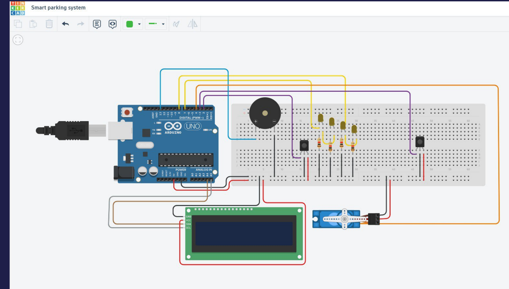
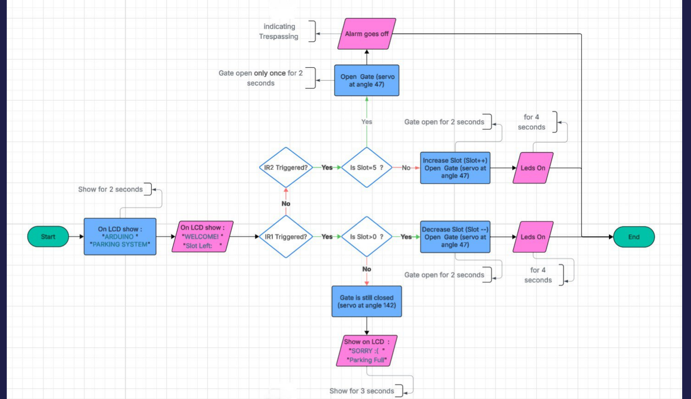
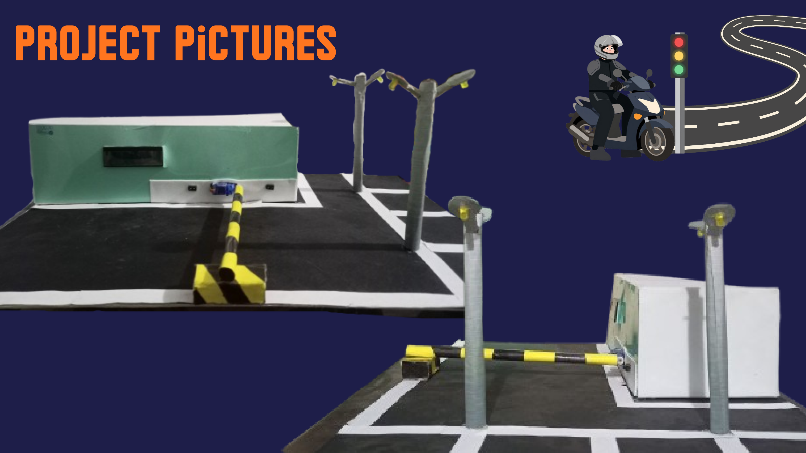

# Arduino Uno Smart Parking System

An Arduino Uno-based parking automation prototype that uses two IR sensors to detect vehicle entry and exit, a servo motor to operate a miniature gate, and an I2C LCD to display the number of available parking spaces.

> **Project scope:** This repository documents an educational hardware prototype. It is not a production parking-management or vehicle-safety system.


## Project overview

The prototype represents a parking area with four spaces. The Arduino maintains a slot counter and responds to two active-LOW IR sensor inputs:

- **Entrance sensor (IR1):** when a vehicle is detected and the counter is greater than zero, the counter is decremented and the servo moves to the gate-open position.
- **Exit sensor (IR2):** when a vehicle is detected, the counter is incremented and the servo moves to the gate-open position.
- **Servo gate:** uses the sketch's configured positions of 47 degrees (open) and 142 degrees (closed).
- **16x2 I2C LCD:** displays a welcome message and the current slot count. When the entry sensor is triggered while the count is zero, the LCD displays a parking-full message.
- **Buzzer:** sounds when the software slot counter exceeds four.

The initial counter value is set to `4` in the sketch. The count is maintained in software; the project does not independently measure whether every physical parking space is occupied.

## Hardware components

The presentation lists the following components:

- Arduino Uno
- Two IR line-tracking / obstacle-detection sensor modules
- SG90 servo motor
- 16x2 LCD with I2C interface
- Buzzer
- LEDs and current-limiting resistors (shown in the presentation wiring diagram)
- Breadboard and jumper wires
- USB cable / suitable power source
- Physical parking model and miniature barrier

## Wiring reference

The pin assignments below are taken from the supplied sketch and presentation. Check the actual prototype wiring before recreating the circuit.

| Component | Arduino Uno connection | Notes |
|---|---:|---|
| Entrance IR sensor (IR1) | D2 | Configured as `INPUT`; detection is active LOW in the sketch |
| Exit IR sensor (IR2) | D3 | Configured as `INPUT`; detection is active LOW in the sketch |
| Servo signal | D4 | The sketch attaches the servo to pin 4 |
| Buzzer | D13 | Used by the over-capacity alert |
| LCD SDA | A4 | I2C data on Arduino Uno |
| LCD SCL | A5 | I2C clock on Arduino Uno |
| LED output | D7 | Declared in the supplied sketch, but not switched on/off by its active code |
| Second LED output | D8 | Shown in the presentation diagram/code screenshots; not present in the supplied sketch |

### Wiring diagram



### System flowchart



### Prototype photographs



## Software requirements

- Arduino IDE
- Arduino AVR board support for Arduino Uno
- `Servo` library (available through the Arduino library ecosystem)
- A compatible `LiquidCrystal_I2C` library
- `Wire` library (included with the Arduino AVR core)

The sketch initializes the LCD using I2C address `0x27`. If the display does not respond, check the module's actual I2C address and the API supported by the installed `LiquidCrystal_I2C` library.

## Uploading the sketch

1. Open `src/SmartParkingSystem/SmartParkingSystem.ino` in the Arduino IDE.
2. Install a compatible `LiquidCrystal_I2C` library if it is not already installed.
3. Connect the Arduino Uno to your computer using USB.
4. In **Tools → Board**, select **Arduino Uno**.
5. In **Tools → Port**, select the port associated with the board.
6. Verify/compile the sketch.
7. Upload it to the Arduino Uno.
8. Test the entrance and exit sensors separately and confirm that the LCD, servo and buzzer respond as expected.

## Important implementation notes

The sketch in `src/SmartParkingSystem/SmartParkingSystem.ino` is based on the code supplied for this repository. The presentation PDF contains screenshots of a different code revision. In particular:

- The supplied sketch declares LED pin D7 and configures it as an output, but the LED activation statements are commented out. It does not currently implement the presentation's four-second lighting behavior.
- The presentation shows LED connections on D7 and D8 and code screenshots with two LED outputs. Those details are not implemented in the supplied sketch.
- The supplied sketch waits 1 second before closing the gate; the presentation's code screenshots show a 2-second delay.
- The supplied exit-sensor logic increments the slot counter without an upper bound. As a result, repeated exit detections can make the counter exceed four and trigger the buzzer. The buzzer indicates an out-of-range counter value; it is not a dedicated intrusion detector.
- The flags and blocking delays provide only basic event handling. A sensor that remains active may be counted again after the flags are reset. A more robust version should detect sensor transitions, debounce inputs, and wait for the sensor to clear.

**Before publishing:** compare this sketch with the exact version used in the demonstration video. If the video shows the LEDs operating or a different gate timing, replace this file with the final tested source and update this section accordingly. Avoid presenting the slide screenshots as proof that the supplied sketch implements those features.

For a fuller comparison of the source sketch and presentation, see [`docs/implementation-notes.md`](docs/implementation-notes.md).

## Future improvements

Ideas listed in the original presentation include:

- Replace the IR sensors with ultrasonic sensors.
- Add an app or IoT dashboard for remote monitoring.
- Explore a DC motor and motor driver for the barrier mechanism.
- Add automatic number-plate recognition.
- Add ticket printing.

These are proposed enhancements, not features currently claimed by this repository.

## Repository structure

```text
arduino-smart-parking-system/
├── README.md
├── .gitignore
├── src/
│   └── SmartParkingSystem/
│       └── SmartParkingSystem.ino
├── docs/
│   ├── Smart-Parking-System-Presentation.pdf
│   ├── wiring-diagram.png
│   ├── system-flowchart.png
│   ├── prototype-photos.png
│   └── implementation-notes.md
└── media/
    └── README.md
```

## Contributors

This was developed as a student team project. Add the contributors' names and GitHub usernames here after confirming that the team members are comfortable being credited in a public repository.

## License

No license is included yet. Since this is a collaborative student project, confirm that the contributors agree to public release and to the chosen reuse terms before adding an open-source license. Without a license, normal copyright restrictions apply.
